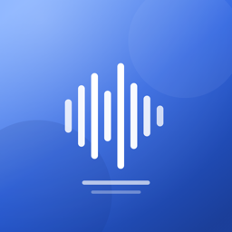
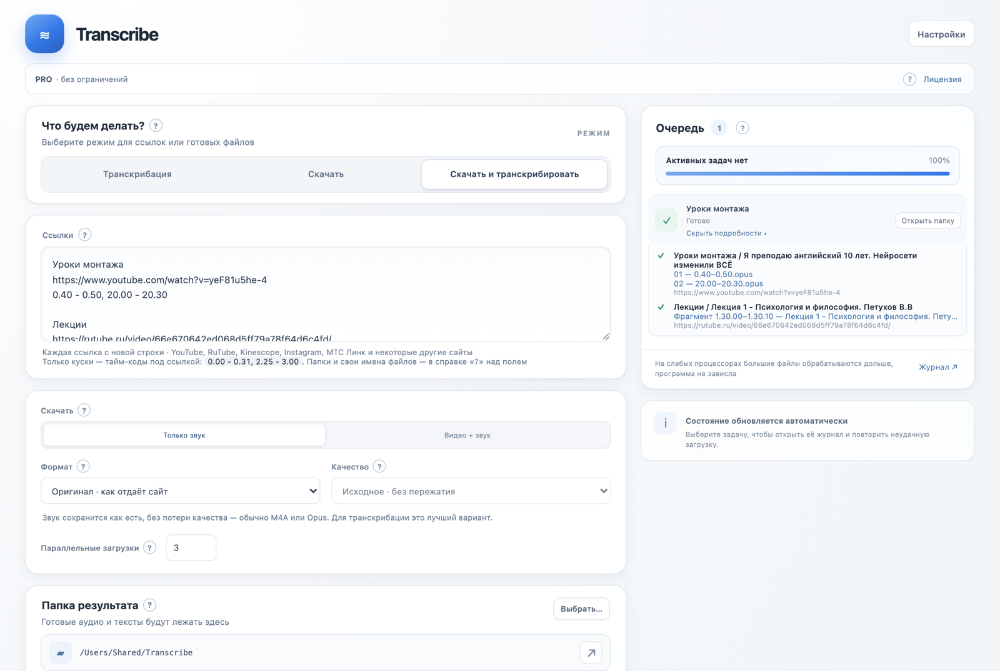
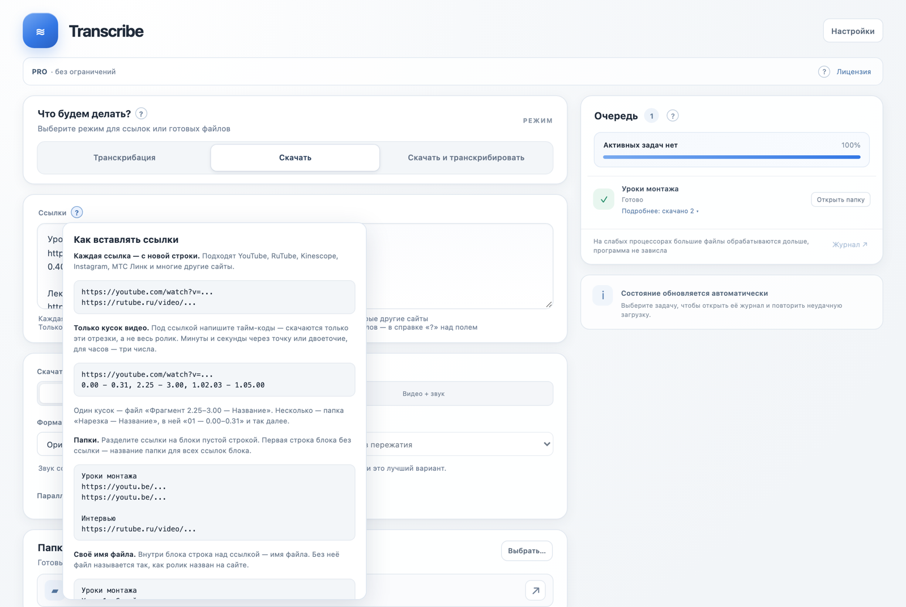
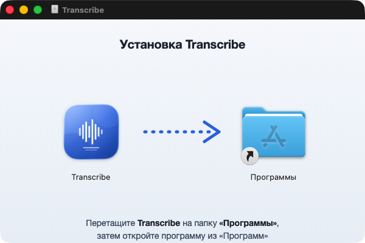
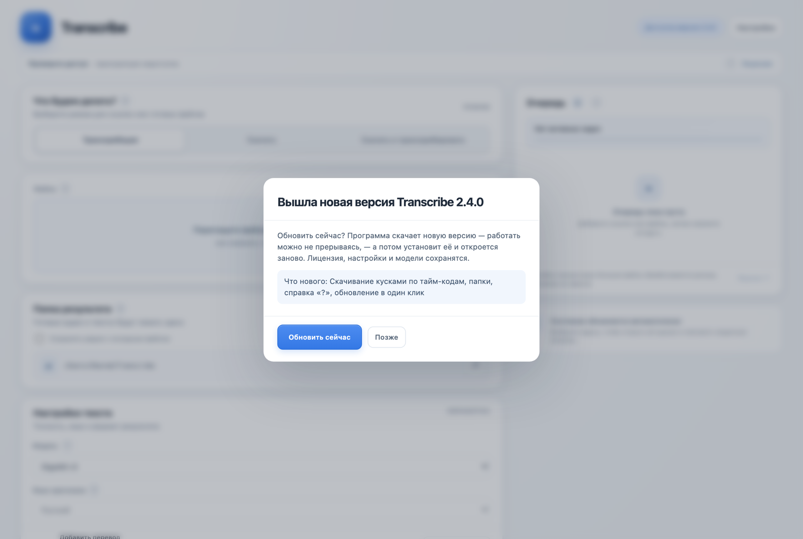
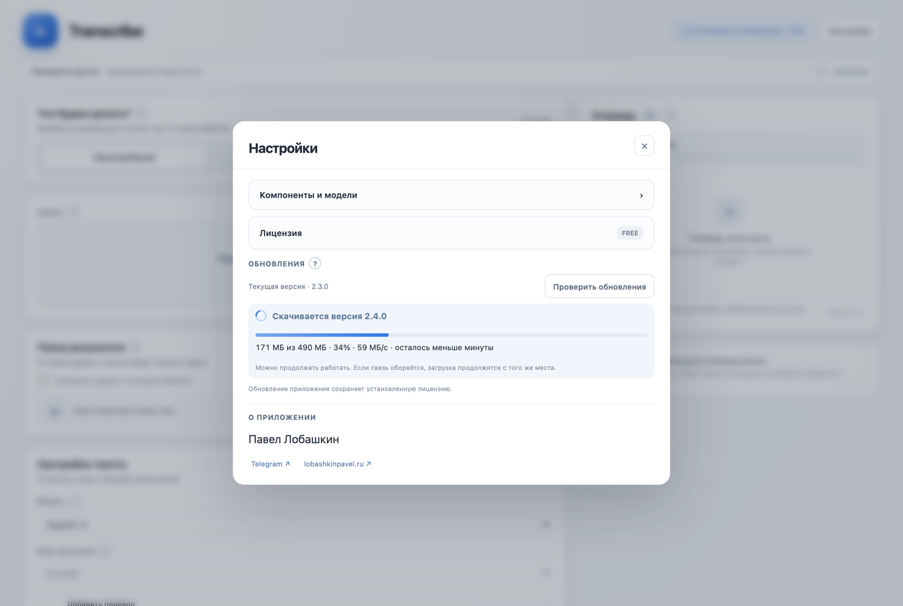

<div align="center">



# Transcribe

**Скачивает видео и звук по ссылкам и превращает речь в текст — прямо на вашем Mac.**<br>
Записи никуда не отправляются: распознавание работает без интернета.

[](https://github.com/xbumixx-code/transcribe/releases/latest)


[](https://t.me/pavel_lobashkin)



</div>

## Что умеет

| | |
|---|---|
| 🎙 **Расшифровка** | Аудио и видео в текст (`.txt`) и субтитры (`.srt`). Файлы и целые папки — перетаскиванием в окно. |
| ⬇️ **Скачивание по ссылкам** | YouTube, RuTube, Kinescope, Instagram, записи вебинаров МТС Линк и многие другие сайты. Звук или видео, MP4 или оригинал, нужное качество. |
| ✂️ **Только нужные куски** | Под ссылкой пишете тайм-коды — скачиваются только эти отрезки. 20 секунд из двухчасовой лекции приходят за секунды, без скачивания всей записи. |
| 📁 **Папки и имена** | Ссылки раскладываются по папкам блоками, файлам можно дать свои названия. |
| ⚡ **Скачать и расшифровать** | Вставили ссылки — получили и записи, и тексты. Удобно для курсов и лекций. |
| 🌍 **Языки и перевод** | Русский, английский и ещё 14 языков. Перевод рядом отдельным файлом (через бесплатную Ollama на вашем Mac). |
| 🧠 **Модели на выбор** | GigaAM v3 — быстрее и точнее всех на русском; Whisper Large-v3 Turbo — много языков. Работают на самом Mac. |
| ❓ **Справка у каждой кнопки** | Значок «?» рядом с каждым блоком объясняет, что это и как пользоваться, с примерами. |
| 🔄 **Обновление в один клик** | Программа сама сообщает о новой версии, скачивает её и переустанавливается. |

## Как вставлять ссылки

Каждая ссылка — с новой строки. Пустая строка начинает новый блок, первая строка блока — название папки. Тайм-коды под ссылкой — только эти куски.

```text
Уроки монтажа
https://www.youtube.com/watch?v=...
0.40 - 0.50, 20.00 - 20.30

Лекции
https://rutube.ru/video/...
1.30.00 - 1.30.10
```

Получится:

```text
Уроки монтажа/
  Нарезка — Название ролика/
    01 — 0.40–0.50
    02 — 20.00–20.30
Лекции/
  Фрагмент 1.30.00–1.30.10 — Название лекции
```

Тайм-коды пишутся через точку или двоеточие: `2.25` — две минуты двадцать пять секунд, `1.02.03` — час, две минуты, три секунды. Всё это подсказывает и сама программа — значок «?» над полем ссылок:

<div align="center"></div>

## Установка

1. Скачайте `Transcribe-arm64-<версия>.dmg` из раздела [Releases](https://github.com/xbumixx-code/transcribe/releases/latest).
2. Откройте его и перетащите Transcribe на папку «Программы».
3. Запустите Transcribe из «Программ». При первом запуске программа предложит скачать компоненты и модель распознавания.

<div align="center"></div>

Приложение подписано сертификатом разработчика и проверено Apple (нотаризация).

## Обновления

При запуске Transcribe сама проверяет, вышла ли новая версия, и спрашивает: «Обновить сейчас» или «Позже». Загрузка идёт в фоне с прогрессом, а после неё одна кнопка — «Установить и перезапустить». Лицензия, настройки и модели сохраняются.

<div align="center">


</div>

> Обновление в один клик работает начиная с версии 2.3.0. С 2.2.0 и раньше один раз обновитесь вручную: скачайте DMG и замените программу в «Программах».

## Бесплатно и PRO

| | Бесплатно | PRO |
|---|---|---|
| Расшифровки | 10 пробных, затем одна в день | без ограничений |
| Скачивания | 10 в день | без ограничений |
| Цена | — | **$49** один раз, навсегда, на один Mac |

Купить PRO — напишите в [Telegram](https://t.me/pavel_lobashkin): после оплаты пришлите код компьютера из окна «Лицензия» и получите ключ. Ключ проверяется без интернета.

## Что нового

Полная история — в [CHANGELOG.md](CHANGELOG.md) и на странице [Releases](https://github.com/xbumixx-code/transcribe/releases).

**2.3.0** — скачивание кусками по тайм-кодам, папки, справка «?» у каждой кнопки, обновление в один клик, подробный итог каждой задачи, понятный установщик.<br>
**2.2.0** — записи вебинаров МТС Линк одним файлом, Instagram, выбор формата.<br>
**2.1.0** — модель GigaAM v3 для русского, Whisper Large-v3 Turbo, проценты при расшифровке, длина субтитров на выбор.<br>
**2.0.0** — первая версия для Mac.

## Требования

- Mac на Apple Silicon (M1 и новее), macOS 14 или новее.
- 8 ГБ памяти хватает для GigaAM и небольших моделей Whisper; для тяжёлых моделей лучше 16 ГБ.
- Интернет нужен только для скачивания по ссылкам, моделей и обновлений.

---

<div align="center">

Автор — **Павел Лобашкин** · [lobashkinpavel.ru](https://www.lobashkinpavel.ru) · [Telegram](https://t.me/pavel_lobashkin)<br>
<sub>В репозитории лежат только установочные файлы и описание.</sub>

</div>
